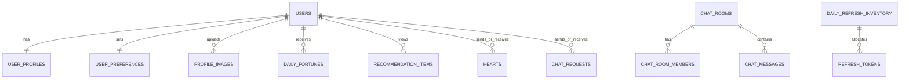

# ERD 및 테이블 정의

## 핵심 관계

## 테이블

| 테이블 | 핵심 컬럼·규칙 |
|---|---|
| `users` | `id`, `email UNIQUE`, `password_hash`, `role(USER/ADMIN)`, `adult_verified_at`, `status`, `last_active_at` |
| `user_profiles` | `user_id PK/FK`, 이름, 생년월일, 성별, 지역, 키, 직업, MBTI, 선택 특성·소개 |
| `user_preferences` | `user_id PK/FK`, 관심 성별·나이, 지역 범위, 특성 조건. 성별·나이 외 `ANY` 허용 |
| `profile_images` | `user_id`, `image_type(ORIGINAL_PRIVATE/AI_PUBLIC/BLURRED_PUBLIC)`, `object_key`, `generation_status` |
| `daily_fortunes` | `user_id`, `fortune_date`, 등급·점수·카드 수·문구; `UNIQUE(user_id, fortune_date)` |
| `recommendation_items` | `viewer_id`, `target_user_id`, 날짜, `INITIAL/REFRESH`, 순서, 이유; `UNIQUE(viewer_id,target_user_id,recommendation_date)` |
| `daily_refresh_inventory` | 날짜 PK, 총량, 잔여량, 갱신 시각 |
| `refresh_tokens` | 사용자, 날짜, `AVAILABLE/USED/EXPIRED`; `UNIQUE(user_id,token_date)` |
| `hearts` | 발신·수신·시각; `UNIQUE(sender_id,receiver_id)` |
| `chat_requests` | 발신·수신·메시지·상태·응답 시각; 동일 쌍 `PENDING` 중복 불가 |
| `chat_rooms`, `chat_room_members`, `chat_messages` | 수락 요청당 방 하나, 방 참여자 2명, 참여자만 메시지 작성 |
| `blocks`, `reports` | 차단·신고·처리 이력 |
| `admin_settings`, `admin_audit_logs`, `user_badges` | 설정·관리자 감사 로그·배지 결과 |

취미는 `user_hobbies(user_id,hobby_code)`, `preferred_hobbies(user_id,hobby_code)` 연결 테이블로 분리한다.

## 선착순권 트랜잭션

1. 당일 `daily_refresh_inventory` 행을 잠근다.
2. 해당 사용자의 오늘 토큰 존재 여부를 확인한다.
3. `remaining_count > 0`이면 1을 차감한다.
4. `refresh_tokens`를 생성한다.
5. 실패 시 전체를 롤백한다.

## 주요 인덱스

| 테이블 | 인덱스 | 목적 |
|---|---|---|
| `users` | `(status,last_active_at)` | 활동 중 후보 조회 |
| `user_profiles` | `(gender,region_code,birth_date)` | 성별·지역·나이 필터 |
| `recommendation_items` | `(viewer_id,recommendation_date,source_type)` | 오늘 카드 조회 |
| `refresh_tokens` | `(user_id,token_date) UNIQUE` | 중복 발급 차단 |
| `chat_requests` | `(receiver_id,status,created_at)` | 받은 요청 조회 |
| `hearts` | `(receiver_id,created_at)` | 최근 30일 배지 집계 |

인기 배지는 최근 30일의 서로 다른 발신자에게 받은 하트와 채팅 요청을 집계하며, 차단·제재·신고 검토 중 계정의 비정상 반응은 제외한다.
