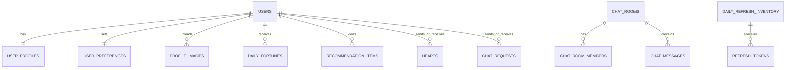

# ERD 및 테이블 정의

## 핵심 관계

## 테이블

| 테이블 | 핵심 컬럼·규칙 |
|---|---|
| `users` | `id`, `email UNIQUE`, `password_hash`, `role(USER/ADMIN)`, `adult_verified_at`, `status`, `last_active_at` |
| `user_profiles` | `user_id PK/FK`, 이름, 생년월일, 성별, 지역, 키, 직업, MBTI, 선택 특성·소개 |
| `user_preferences` | `user_id PK/FK`, 관심 성별·나이, 지역 범위, 특성 조건. 성별·나이 외 `ANY` 허용 |
| `profile_images` | `user_id`, `image_type(ORIGINAL_PRIVATE/AI_PUBLIC/BLURRED_PUBLIC)`, `object_key`, `generation_status` |
| `daily_fortunes` | `user_id`, `fortune_date`, 등급·점수·카드 수·문구; `UNIQUE(user_id, fortune_date)` |
| `recommendation_items` | `viewer_id`, `target_user_id`, 날짜, `INITIAL/REFRESH`, 순서, 이유; `UNIQUE(viewer_id,target_user_id,recommendation_date)` |
| `daily_refresh_inventory` | 날짜 PK, 총량, 잔여량, 갱신 시각 |
| `refresh_tokens` | 사용자, 날짜, `AVAILABLE/USED/EXPIRED`; `UNIQUE(user_id,token_date)` |
| `hearts` | 발신·수신·시각; `UNIQUE(sender_id,receiver_id)` |
| `chat_requests` | 발신·수신·메시지·상태·응답 시각; 동일 쌍 `PENDING` 중복 불가 |
| `chat_rooms`, `chat_room_members`, `chat_messages` | 수락 요청당 방 하나, 방 참여자 2명, 참여자만 메시지 작성 |
| `blocks`, `reports` | 차단·신고·처리 이력 |
| `admin_settings`, `admin_audit_logs`, `user_badges` | 설정·관리자 감사 로그·배지 결과 |

취미는 `user_hobbies(user_id,hobby_code)`, `preferred_hobbies(user_id,hobby_code)` 연결 테이블로 분리한다.

## 선착순권 트랜잭션

1. 당일 `daily_refresh_inventory` 행을 잠근다.
2. 해당 사용자의 오늘 토큰 존재 여부를 확인한다.
3. `remaining_count > 0`이면 1을 차감한다.
4. `refresh_tokens`를 생성한다.
5. 실패 시 전체를 롤백한다.

## 주요 인덱스

| 테이블 | 인덱스 | 목적 |
|---|---|---|
| `users` | `(status,last_active_at)` | 활동 중 후보 조회 |
| `user_profiles` | `(gender,region_code,birth_date)` | 성별·지역·나이 필터 |
| `recommendation_items` | `(viewer_id,recommendation_date,source_type)` | 오늘 카드 조회 |
| `refresh_tokens` | `(user_id,token_date) UNIQUE` | 중복 발급 차단 |
| `chat_requests` | `(receiver_id,status,created_at)` | 받은 요청 조회 |
| `hearts` | `(receiver_id,created_at)` | 최근 30일 배지 집계 |

인기 배지는 최근 30일의 서로 다른 발신자에게 받은 하트와 채팅 요청을 집계하며, 차단·제재·신고 검토 중 계정의 비정상 반응은 제외한다.

---

# Phase 2 변경

`docs/03_API_명세서.md`의 Phase 2 계약을 구현하는 데 필요한 추가분만 적는다. 위 "테이블" 절의 기존 정의는 그대로 유지한다.

## Phase 1 구현 현황

현재 마이그레이션(`backend/prisma/migrations/2026102301_phase1_base`)이 실제로 만드는 테이블은 3개다.

| 테이블 | 마이그레이션 | 비고 |
|---|---|---|
| `users` | 있음 | |
| `user_profiles` | 있음 | |
| `user_preferences` | 있음 | |
| `profile_images` | **구현됨(Phase 2)** | `2026102302_add_profile_images` 마이그레이션으로 생성한다. |
| `daily_fortunes` | **구현됨(Phase 2)** | `2026102303_add_home_tables` 마이그레이션으로 생성한다. |
| `recommendation_items` | **구현됨(Phase 2)** | `2026102303_add_home_tables` 마이그레이션으로 생성한다. |
| `daily_refresh_inventory` | **구현됨(Phase 2)** | `2026102303_add_home_tables` 마이그레이션으로 생성한다. 날짜 PK 컬럼 이름은 공통 규칙에 따라 `service_date`다. |
| `refresh_tokens` | **구현됨(Phase 2)** | `2026102303_add_home_tables` 마이그레이션으로 생성한다. `token_date`가 `daily_refresh_inventory.service_date`를 참조한다. |
| `blocks` | **구현됨(Phase 2)** | `2026102303_add_home_tables` 마이그레이션으로 생성한다. 추천 목록의 양방향 차단 필터에 필요해 함께 만들었다. |
| `reports` | **구현됨(Phase 2)** | `2026102305_add_reports` 마이그레이션으로 생성한다. 중복 신고 차단은 MySQL 부분 유일 인덱스를 쓸 수 없어 애플리케이션이 트랜잭션 안에서 검사한다. `target_type`이 `MESSAGE`인 `target_id`에는 외래키를 걸지 않았다. |
| `admin_settings` | **구현됨(Phase 2)** | `2026102306_add_admin_tables` 마이그레이션으로 생성한다. PK는 `(setting_key, effective_service_date)`다. |
| `admin_audit_logs` | **구현됨(Phase 2)** | 같은 마이그레이션. 관리자·작업별 조회 인덱스를 함께 두었다. `admin_id`와 `target_id`에는 외래키를 걸지 않았다. 대상이 사용자·신고·설정으로 바뀌기 때문이다. |
| `user_badges` | 없음 | 관리자 API에 필요하지 않아 아직 만들지 않았다. |
| `hearts` | **구현됨(Phase 2)** | `2026102304_add_heart_chat_tables` 마이그레이션으로 생성한다. |
| `chat_requests` | **구현됨(Phase 2)** | 같은 테이블. 동일 쌍 `PENDING` 중복 금지는 MySQL 부분 유일 인덱스를 쓸 수 없어 애플리케이션이 트랜잭션 안에서 검사한다. |
| `chat_rooms` | **구현됨(Phase 2)** | 같은 테이블. "수락 요청당 방 하나"를 `chat_request_id UNIQUE` 외래키로 표현했다. |
| `chat_room_members` | **구현됨(Phase 2)** | 같은 테이블. PK는 `id`이고 `UNIQUE(room_id, user_id)`로 참여자 중복을 막는다. 참여자 2명 제한은 애플리케이션이 지킨다. |
| `chat_messages` | **구현됨(Phase 2)** | 같은 테이블. |

아래 나머지 테이블도 모두 미구현 상태이며 Phase 2 마이그레이션에서 생성한다.

## 공통 컬럼 규칙 — Phase 2 변경

새로 만드는 모든 테이블에 공통 적용한다.

| 규칙 | 내용 |
|---|---|
| 기본 키 | `id BIGINT AUTO_INCREMENT`. 단일 사용자 1행 테이블은 `user_id`를 그대로 PK로 쓴다. |
| 시각 컬럼 | `DATETIME(3)`에 UTC로 저장한다. 애플리케이션이 시간대를 변환한다. |
| 서비스 날짜 | `service_date DATE`. 한국 시간 오전 8시 기준으로 서버가 계산해 넣는다. 기존 문서의 `fortune_date`, `recommendation_date`, `token_date`도 같은 기준이다. |
| 생성·수정 시각 | `created_at`, `updated_at`을 둔다. 단순 이력 테이블은 `created_at`만 둔다. |
| 문자셋 | `utf8mb4` / `utf8mb4_unicode_ci` |
| 삭제 | 상호작용 이력은 실제 삭제하지 않고 상태·취소 시각으로 표시한다. 집계 왜곡을 막기 위함이다. |

## 테이블별 추가 컬럼 — Phase 2 변경

### `profile_images`

| 컬럼 | 타입 | 설명 |
|---|---|---|
| `slot` | `TINYINT` | 1~3. 사용자당 최대 3장. `UNIQUE(user_id, slot, image_type)` |
| `generation_status` | `ENUM('PENDING','PROCESSING','DONE','FAILED')` | API의 `generationStatus`와 1:1 대응 |
| `byte_size` | `INT` | 업로드 용량 검사 결과 기록 |
| `width`, `height` | `SMALLINT` | 픽셀 한도 검사 결과 기록 |
| `processed_at` | `DATETIME(3) NULL` | 변환 완료 시각 |
| `failed_reason_code` | `VARCHAR(40) NULL` | 변환 실패 사유. 원본을 대신 공개하지 않기 위한 판단 근거 |

- slot 하나에 원본·AI·블러 3가지 버전이 각각 별도 행으로 저장되므로 `image_type`을 유일 조건에 포함한다.
- `image_type`은 기존 정의대로 `ORIGINAL_PRIVATE` / `AI_PUBLIC` / `BLURRED_PUBLIC`이다.
- `object_key`만 저장하고 완성된 URL은 저장하지 않는다. 원본 URL은 요청 시마다 60초 임시 URL로 발급한다.
- object key에 이름·이메일·생년월일·원래 파일명을 넣지 않는다.

### `daily_fortunes`

| 컬럼 | 타입 | 설명 |
|---|---|---|
| `grade` | `ENUM('BAD','NORMAL','GOOD','GREAT')` | API의 `fortune.grade` |
| `score` | `TINYINT UNSIGNED` | 0~100 |
| `card_count` | `TINYINT` | 3·5·7 |
| `message` | `VARCHAR(200)` | 운세 문구 |
| `opened_at` | `DATETIME(3) NULL` | **최초** 공개 호출 시각. 두 번째 호출부터 갱신하지 않는다. `POST /daily/open`의 멱등성 판정과 선착순 순서 판별에 쓴다. |

`UNIQUE(user_id, fortune_date)`는 기존 정의대로 유지한다.

### `recommendation_items`

| 컬럼 | 타입 | 설명 |
|---|---|---|
| `source_type` | `ENUM('INITIAL','REFRESH')` | 기본 묶음 / 새로고침 묶음 |
| `display_order` | `TINYINT` | 카드 표시 순서 |
| `reason_code` | `VARCHAR(40)` | 추천 이유 코드. 화면 문구는 애플리케이션이 만든다 |

`UNIQUE(viewer_id, target_user_id, recommendation_date)`는 기존 정의대로 유지한다. 같은 날 기본 묶음과 새로고침 묶음에 같은 상대가 중복 등장하지 않게 하는 장치다.

### `daily_refresh_inventory`

| 컬럼 | 타입 | 설명 |
|---|---|---|
| `granted_count` | `INT` | 실제 발급 수. `total_count - remaining_count`와 일치하는지 검증용 |
| `configured_by_admin_id` | `BIGINT NULL` | 관리자가 N을 설정한 경우의 관리자 ID |
| `configured_at` | `DATETIME(3) NULL` | 설정 시각 |

### `refresh_tokens`

| 컬럼 | 타입 | 설명 |
|---|---|---|
| `expires_at` | `DATETIME(3)` | 다음 날 오전 8시(KST)에 해당하는 UTC 시각 |
| `used_at` | `DATETIME(3) NULL` | 사용 시각. 재시도 중복 사용 차단의 기준 |
| `granted_rank` | `INT NULL` | 선착순 몇 번째로 받았는지. 운영 검증용 |

`status`는 기존 정의대로 `AVAILABLE` / `USED` / `EXPIRED`, `UNIQUE(user_id, token_date)`를 유지한다.

### `hearts`

| 컬럼 | 타입 | 설명 |
|---|---|---|
| `canceled_at` | `DATETIME(3) NULL` | 취소 시각. **행을 삭제하지 않는다.** |

- `UNIQUE(sender_id, receiver_id)`는 유지한다. 취소 후 다시 보내면 같은 행의 `canceled_at`을 `NULL`로 되돌린다.
- 받은 하트 목록과 인기 배지 집계는 `canceled_at IS NULL`인 행만 센다.
- 행을 지우지 않는 이유: 보내고 취소하기를 반복해 배지 집계를 조작하는 것을 탐지할 수 있어야 한다.

### `chat_requests`

| 컬럼 | 타입 | 설명 |
|---|---|---|
| `source_type` | `ENUM('RECOMMENDATION','RECEIVED_HEART')` | 추천 카드에서 보냈는지, 받은 하트에서 보냈는지. `CHAT_REQUEST_NOT_ALLOWED` 검사 근거를 남긴다 |
| `service_date` | `DATE` | 요청을 보낸 서비스 날짜. 같은 날 재요청 금지 규칙의 기준 |

`status`에 **`IGNORED`를 추가**한다: `PENDING` / `ACCEPTED` / `REJECTED` / `IGNORED`. UX 시나리오의 "무시"를 표현하기 위한 추가이며, 발신자에게는 `PENDING`으로 보이게 애플리케이션이 변환한다.

동일 쌍 `PENDING` 중복 금지는 기존 정의대로 유지한다.

### `chat_room_members`

| 컬럼 | 타입 | 설명 |
|---|---|---|
| `last_read_message_id` | `BIGINT NULL` | 읽음 위치. `GET /chat-rooms`의 `unreadCount` 계산에 쓴다 |
| `last_read_at` | `DATETIME(3) NULL` | 읽음 갱신 시각 |

### `chat_messages`

| 컬럼 | 타입 | 설명 |
|---|---|---|
| `client_message_id` | `VARCHAR(64) NULL` | 클라이언트가 보낸 중복 방지 키. `UNIQUE(room_id, sender_id, client_message_id)` |

- `body`는 `VARCHAR(1000)`이다. 메시지 본문은 로그에 남기지 않는다.

### `reports`

| 컬럼 | 타입 | 설명 |
|---|---|---|
| `target_type` | `ENUM('USER','MESSAGE')` | 신고 대상 종류 |
| `target_id` | `BIGINT` | 사용자 ID 또는 메시지 ID |
| `reason_code` | `ENUM('SPAM','ABUSE','SEXUAL','FAKE_PROFILE','UNDERAGE','OTHER')` | 신고 사유 |
| `detail` | `VARCHAR(500) NULL` | 신고자 설명 |
| `status` | `ENUM('PENDING','REVIEWING','RESOLVED','DISMISSED')` | 처리 상태 |
| `handled_by_admin_id` | `BIGINT NULL` | 처리한 관리자 |
| `handled_at` | `DATETIME(3) NULL` | 처리 시각 |
| `result_note` | `VARCHAR(500) NULL` | 처리 결과 기록. 신고자에게 노출하지 않는다 |

- 중복 신고 차단: 같은 `reporter_id`, `target_type`, `target_id`, `reason_code` 조합에 `status`가 `PENDING` 또는 `REVIEWING`인 행이 있으면 새로 만들지 않는다.
- `target_type`이 `MESSAGE`일 때 `target_id`는 다른 테이블을 가리키므로 외래 키를 걸지 않고 애플리케이션이 존재와 권한을 확인한다.

### `admin_settings`

키-값 구조로 정의한다.

| 컬럼 | 타입 | 설명 |
|---|---|---|
| `setting_key` | `VARCHAR(60)` | PK의 일부. 예: `BADGE_POPULAR_MIN_UNIQUE_HEARTS`, `DAILY_REFRESH_TOTAL` |
| `setting_value` | `JSON` | 값 |
| `effective_service_date` | `DATE` | 이 값이 적용되기 시작하는 서비스 날짜. PK의 일부 |
| `updated_by_admin_id` | `BIGINT` | 변경한 관리자 |
| `updated_at` | `DATETIME(3)` | 변경 시각 |

- PK는 `(setting_key, effective_service_date)`다. 과거 값을 지우지 않고 이력으로 남긴다.
- 선착순 N 변경은 **다음 서비스 날짜**를 `effective_service_date`로 하여 새 행을 넣는다. 당일 재고는 다시 채우지 않는다.

### `user_badges`

| 컬럼 | 타입 | 설명 |
|---|---|---|
| `badge_code` | `VARCHAR(30)` | 현재는 `POPULAR`만 사용 |
| `service_date` | `DATE` | 부여된 서비스 날짜. `UNIQUE(user_id, badge_code, service_date)` |
| `computed_at` | `DATETIME(3)` | 집계 실행 시각 |

- 집계 수치는 저장하되 API 응답에는 포함하지 않는다. 부여 여부만 `PublicCard.badges`로 내보낸다.

### `admin_audit_logs`

| 컬럼 | 타입 | 설명 |
|---|---|---|
| `admin_id` | `BIGINT` | 관리자 |
| `request_id` | `VARCHAR(64)` | 요청 추적 ID |
| `action` | `VARCHAR(60)` | 예: `USER_SANCTION`, `REPORT_HANDLE`, `SETTING_BADGE`, `SETTING_DAILY_REFRESH` |
| `target_type`, `target_id` | `VARCHAR(30)`, `BIGINT` | 대상 |
| `before_value`, `after_value` | `JSON NULL` | 변경 전후 값 |
| `result` | `ENUM('SUCCESS','FAILURE')` | 결과 |
| `created_at` | `DATETIME(3)` | UTC 시각 |

- 제재·신고 처리·설정 변경은 **본 변경과 같은 트랜잭션**으로 기록한다.
- 토큰, 비밀번호, 채팅 본문, 사진 서명 URL은 기록하지 않는다.

## 추가 인덱스 — Phase 2 변경

커서 방식 페이지네이션과 목록 필터를 위해 추가한다. 기존 "주요 인덱스" 절의 인덱스는 유지한다.

| 테이블 | 인덱스 | 목적 |
|---|---|---|
| `hearts` | `(receiver_id, canceled_at, id DESC)` | 받은 하트 목록 커서 조회 |
| `chat_requests` | `(receiver_id, status, id DESC)` | 받은 요청 목록 커서 조회 |
| `chat_requests` | `(sender_id, status, id DESC)` | 보낸 요청 목록 커서 조회 |
| `chat_requests` | `(sender_id, receiver_id, service_date)` | 같은 날 재요청 금지 검사 |
| `chat_room_members` | `(user_id, room_id)` | 내 채팅방 목록 |
| `chat_messages` | `(room_id, id DESC)` | 메시지 커서 조회 |
| `blocks` | `(blocker_id, target_user_id)` 및 `(target_user_id, blocker_id)` | 양방향 차단 검사 |
| `reports` | `(status, created_at)` | 관리자 신고 목록 |
| `reports` | `(reporter_id, target_type, target_id, reason_code, status)` | 중복 신고 차단 |
| `profile_images` | `(user_id, image_type, generation_status)` | 공개 이미지 선택, 상태 조회 |
| `refresh_tokens` | `(token_date, granted_rank)` | 선착순 발급 검증 |
| `user_badges` | `(user_id, service_date)` | 카드에 배지 표기 |

## 보안 제약이 스키마에 남기는 조건 — Phase 2 변경

| 조건 | 스키마에서의 표현 |
|---|---|
| 원본 사진 URL을 영구 저장하지 않는다 | `profile_images`에 `object_key`만 두고 URL 컬럼을 두지 않는다 |
| 원본과 공개 이미지를 분리한다 | `image_type`으로 구분하고 버킷·경로 접두사를 분리한다 |
| 수락 전 상세 프로필을 주지 않는다 | 공개 카드용 조회와 수락 후 조회를 애플리케이션 계층에서 분리한다. 스키마는 같은 테이블을 쓴다 |
| 차단·정지·탈퇴 상대 제외 | `users.status`와 `blocks` 양방향 인덱스로 모든 목록 쿼리에서 조인 필터를 건다 |
| 선착순 원자적 차감 | `daily_refresh_inventory` 당일 행을 잠근 뒤 `remaining_count`를 차감하고 `refresh_tokens`를 생성한다. 기존 "선착순권 트랜잭션" 절의 순서를 그대로 따른다 |
| 설정 변경 이력 보존 | `admin_settings`를 `(setting_key, effective_service_date)` 복합 PK로 두어 덮어쓰지 않는다 |

## 미결정 사항

구현 전에 담당자 합의가 필요한 항목이다.

| 항목 | 내용 | 물어볼 담당 |
|---|---|---|
| 취미 코드 목록 | `user_hobbies.hobby_code`, `preferred_hobbies.hobby_code`의 실제 코드 집합이 정해지지 않았다 | 프론트엔드 |
| 거절·무시 후 재요청 | 현재 계약은 같은 서비스 날짜 재요청 불가. 다음 날 허용 여부가 미정이다 | 프론트엔드·보안 |
| 차단 후 상세 프로필 노출 범위 | 원본 사진은 차단 즉시 중단으로 확정. 소개·취미 등 텍스트 노출 여부가 미정이다 | 보안·운영 |
| 속도 제한 저장소 | 임계값 카운터를 DB에 둘지 별도 캐시에 둘지 미정이다. 테이블로 둘 경우 `rate_limit_counters` 추가가 필요하다 | 인프라·보안 |
| 탈퇴 후 데이터 보관 기간 | `WITHDRAWN` 상태 유지 기간과 완전 삭제 기준이 미정이다 | 보안·운영 |
| 관리자 원본 사진 검수 | 관리자에게 원본 조회 권한을 주지 않는 것이 현재 기준이다. 검수가 필요하면 별도 설계가 필요하다 | 보안·운영 |
