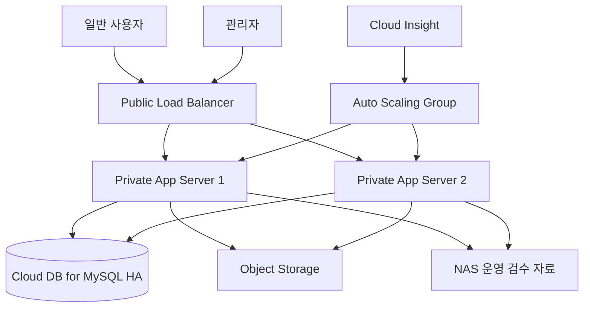

# NCP 아키텍처

## 설계 목표

1. 오전 8시 운세 확인·선착순 새로고침권 지급의 동시 접속을 안정적으로 처리한다.
2. 실제 사진·채팅·개인정보를 외부에 직접 노출하지 않는다.
3. 웹 서버 한 대 장애에도 서비스를 유지한다.
4. 사용자·추천·선착순권 데이터를 HA·자동 백업·시점 복원으로 보호한다.

## 논리 구성도

## VPC·보안 분리

| 영역 | 구성 | 접근 규칙 |
|---|---|---|
| Public Subnet | Load Balancer, 인터넷 구간 | HTTP 80 수신. 도메인을 확보하지 못해 인증서를 붙이지 않았다(07 참고) |
| Public Subnet | NAT Gateway 전용 | 앱 서브넷의 아웃바운드 경로 |
| Private App Subnet | 웹·API·Auto Scaling 서버 | LB와 운영 경로만 접근 |
| Private DB Subnet | Cloud DB for MySQL | App Server ACG만 MySQL 포트 허용 |
| Object Storage | 원본 사진·공개 변환 이미지 | 서버 권한 검증 뒤 URL 발급 |
| NAS | 관리자 검수·운영 자료 | 운영자·승인 서버만 접근 |

- ACG는 LB → 앱의 8080(API)과 5173(프론트), 앱 → DB의 MySQL 포트만 허용한다.
- 앱 서버에는 API 컨테이너와 프론트 컨테이너가 함께 뜬다. LB가 경로로 나눠 보낸다(`/api/*`는 8080, 나머지는 5173).
- 앱 ACG의 아웃바운드도 열어야 한다. Container Registry와 Object Storage가 공인 주소라, 막히면 서버가 기동하지 못한다.
- NACL은 Subnet 단위로 불필요한 인·아웃바운드를 차단한다.
- 원본은 Private Object Storage에 저장하고 수락 전 Object Key·URL을 클라이언트에 전달하지 않는다.

## 서버·배포

| NCP 기능 | 적용 |
|---|---|
| Server | 웹·API를 최소 2대로 구성 |
| Init Script·내 서버 이미지 | 시작 환경·서비스 실행 자동화, Auto Scaling 서버 동일 구성 |
| Block Storage | OS·실행 데이터 저장 |
| Load Balancer | 요청 분산, 비정상 서버 헬스체크 제외 |
| Auto Scaling | 8시 증설, 평시 최소 대수 축소 |
| Cloud Insight | CPU·요청·응답 시간·오류율·서버 수 감시 |
| Cloud DB for MySQL | HA·자동 백업·시점 복원 |

## 오전 8시 처리

1. 8시 전 배치가 운세 등급과 추천 후보를 미리 계산해 DB에 저장한다.
2. 8시에 운세·카드를 공개한다.
3. 운세 확인 요청은 DB 트랜잭션으로 선착순권 재고를 차감한다.
4. LB가 요청을 분산하고, 임계치 초과 시 Cloud Insight가 Auto Scaling을 유도한다.
5. 부하 감소 후 서버를 축소한다.

추천 계산을 미리 수행하고 실시간에는 재고 처리만 하여, 트래픽 봉우리와 무거운 추천 연산을 분리한다.

## 데이터 보호·발표 검증

| 대상 | 보호·검증 |
|---|---|
| Cloud DB | HA·자동 백업·PITR, 테스트 DB 시점 복원 |
| 실제 사진 | Private Storage·권한 뒤 임시 URL, 미수락 접근 차단 테스트 |
| 공개 이미지 | 별도 공개 경로, 카드 표시 확인 |
| 서버 | 이미지·Init Script, 서버 종료 뒤 Auto Scaling 재생성 확인 |
| 선착순권 | 부하 테스트 후 설정 N개만 발급됐는지 DB 확인 |

추가 시연: 평상시 서버 2대 → 8시 동시 요청 부하 재현 → Cloud Insight 지표·Auto Scaling 확인 → 인기 배지 쿼리 인덱스 적용 전후 비교.
